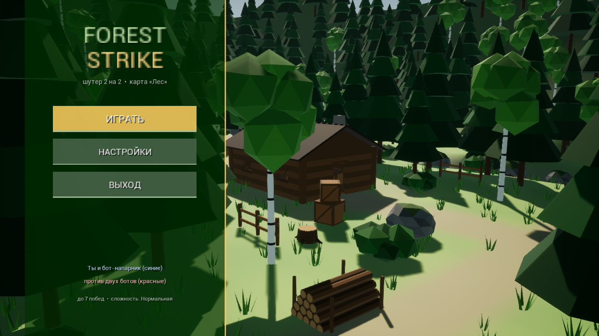
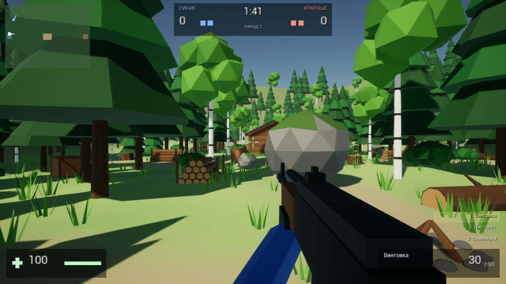
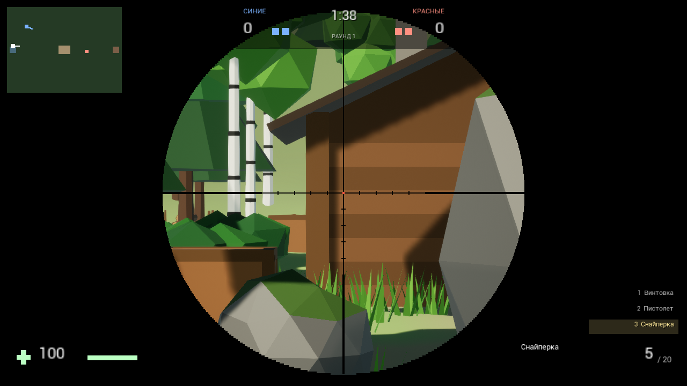

# Forest Strike 🌲🔫

Шутер от первого лица **2 на 2** в лесу. Ты и бот-напарник (синие) против двух ботов (красные), раунды на выбывание.
Сделано на **Unreal Engine 4.27** (C++), модели и звуки — процедурно в **Blender**.

## ▶️ Играть в браузере (без скачивания)

**[yamilishmuratov-wq.github.io/forest-strike](https://yamilishmuratov-wq.github.io/forest-strike/)** — открой ссылку, нажми «Играть», кликни по экрану, чтобы захватить мышь.
Работает в Chrome, Edge, Яндекс Браузере и Firefox на компьютере. На слабом ПК поставь в настройках «Графика: Низкая».

## ⬇️ Скачать версию на Unreal Engine (Windows)

**[Скачать последнюю версию](../../releases/latest)** → файл `ForestStrike_Game.zip` (~150 МБ).

1. Распакуй архив в любую папку.
2. Запусти `ForestStrike.exe`.
3. Если Windows покажет «Windows защитила ваш компьютер» — нажми **Подробнее → Выполнить в любом случае** (игра не подписана).
4. Если не хватает библиотек — один раз запусти `Engine\Extras\Redist\en-us\UE4PrereqSetup_x64.exe`.

Нужно: Windows 10/11 64-bit, видеокарта с DirectX 11.

## Управление

| Клавиша | Действие |
|---|---|
| WASD, мышь | движение, обзор |
| ЛКМ / ПКМ | огонь / прицел (у снайперки — оптика) |
| R | перезарядка |
| 1 / 2 / 3 / Q | винтовка / пистолет / снайперка / смена |
| Ctrl | присесть |
| Shift | тихий шаг |
| Пробел | прыжок |
| Tab | счёт |
| Esc | пауза и меню |

## Фишки

- Карта «Лес»: избушка в центре, опушка на севере, овраг на юге, лагерь и лесопилка на спавнах.
- Кусты прячут тебя от ботов, пока ты не стреляешь. Бег слышно — тихий шаг и присед бесшумны.
- Винтовка, пистолет и снайперка с оптикой; урон по зонам, хедшоты, отдача и разброс.
- Боты ходят по линиям, держат позиции, реагируют на звуки, у части — снайперки.
- Настройки: чувствительность мыши, сложность ботов, число раундов, громкость.
